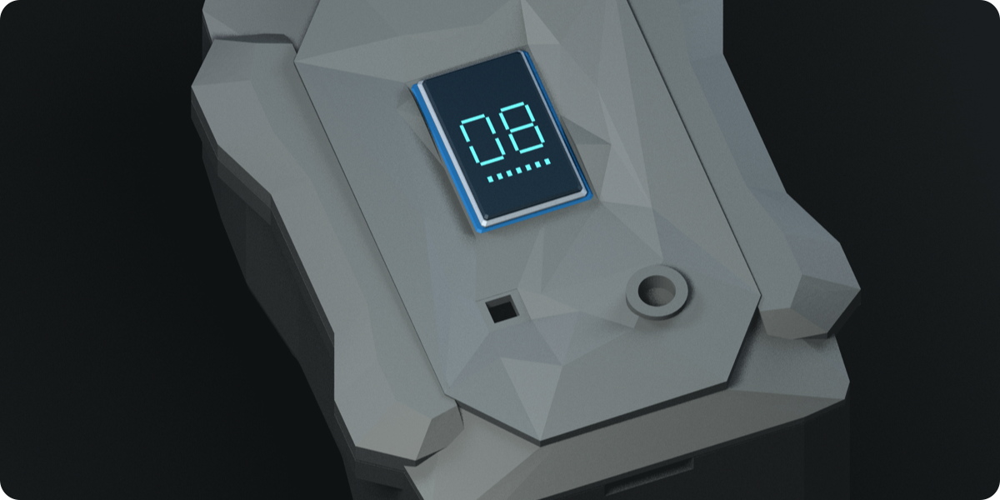
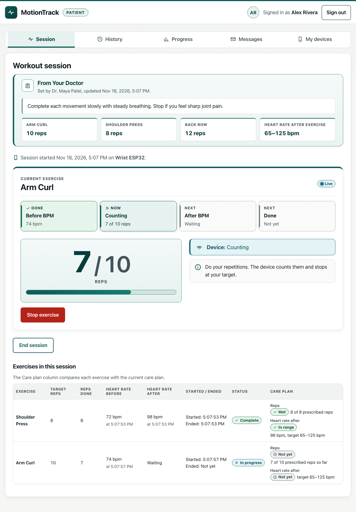
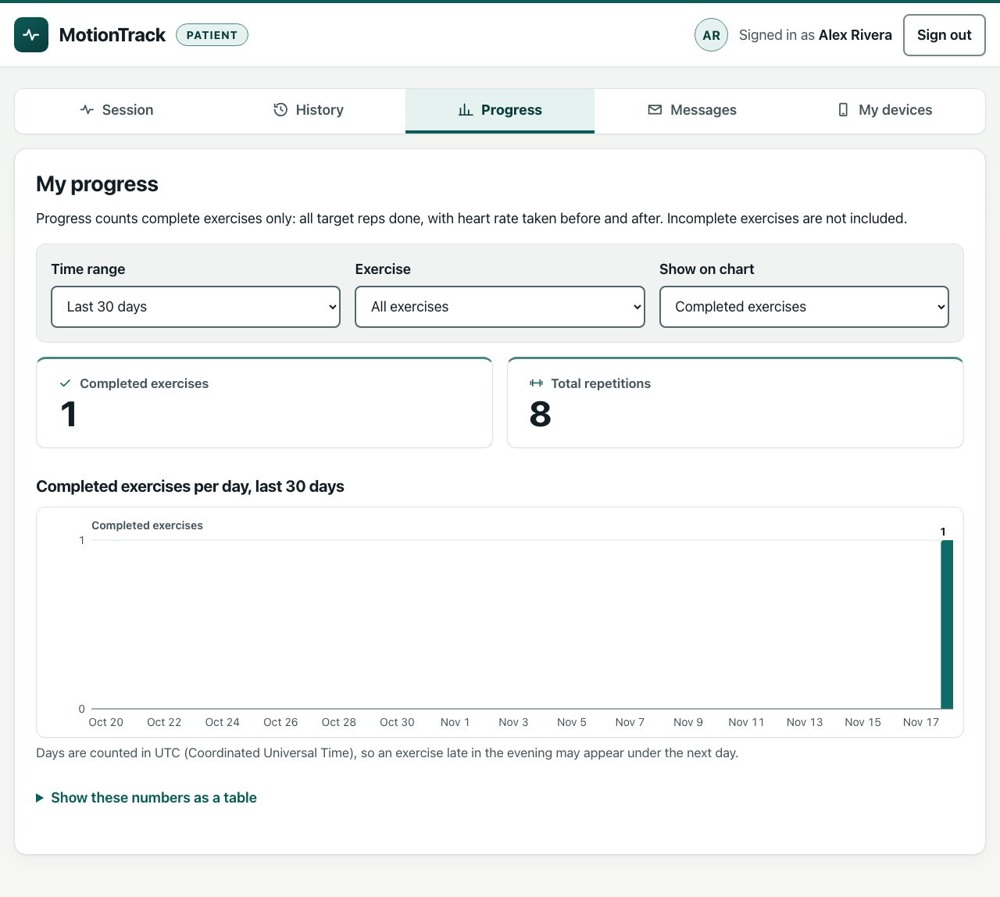
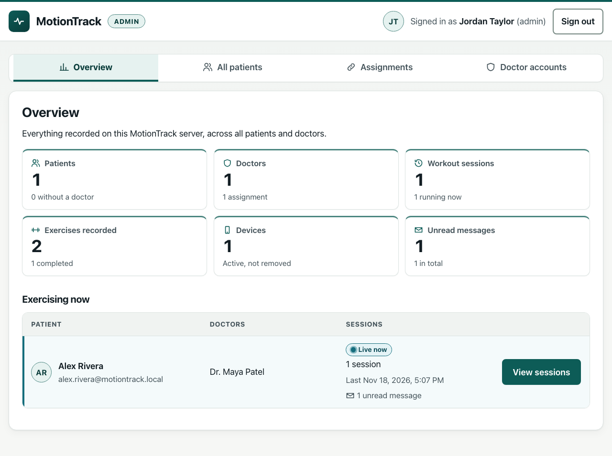
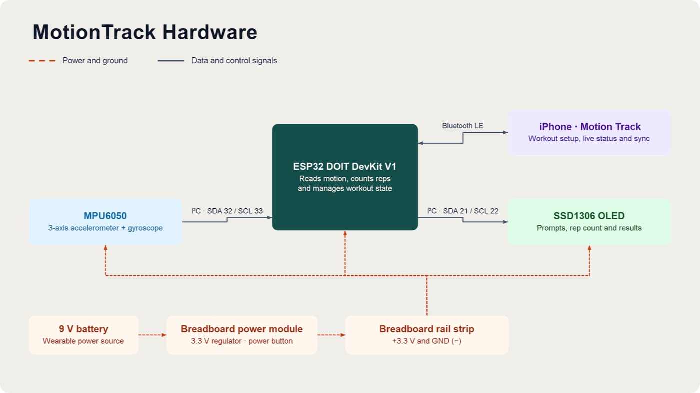

# Motion Track

**A wrist-worn rep counter and a shared exercise record for rehabilitation, in clinic and at home.**

University of Waterloo · ECE 198 · Group 65

[Project brief](#problem-we-are-solving) · [Watch the demo](#web-demo) · [Test results](#wearable--software-test-results) · [Run locally](#quick-start)



*The “Diamond Ends” enclosure in Fusion CAD. The OLED readout is illustrative.*

## Problem we are solving

The University of Waterloo’s *F26 ECE 198 Project Overview* (pp. 1–3) asks teams to help CCCARE scale exercise care for older adults. **Motion Track primarily addresses Sub Problem 2, Exercise Tracking and Measurement.** One instructor may supervise 10–12 participants in a session, or up to 30 program graduates. It is hard to see who completed their prescribed reps and who stopped early or did more than planned.

Motion Track gives instructors a record of each set when they cannot observe every participant. For the three supported exercises, the wearable counts a rep when the movement meets that exercise’s lift and return rules.

- **Sub Problem 1, Scale Personalized Care.** Clinicians can set and adjust rep targets and a heart-rate range in a shared care plan. The dashboard compares recorded workouts with the current targets to inform follow-up.
- **Sub Problem 3, Remote (At Home) Care.** Participants can see their prescribed targets and record supported exercises at home. The iPhone app saves workouts offline and syncs them when a connection returns so their assigned clinician can review them remotely.

## Overview

1. **Wearable.** The ESP32 counts biceps curls, shoulder presses, and back rows and shows progress toward the selected rep target on the OLED.
2. **iPhone.** The app receives reps and elapsed time over Bluetooth and saves the set with its before-and-after heart-rate check-ins. It queues workouts offline and syncs them when a connection returns.
3. **Dashboard.** Patients see their exercise history. Their assigned clinician can review the same record and compare it with the care plan.

A set is **Complete** when the wearable counts all target reps and the record includes both heart-rate readings. Other sets are **Incomplete**. Retried uploads use the same `client_id` so each set appears once.

## Web Demo

The 31-second walkthrough follows a simulated rep from the wrist-sensor demo through the Patient, Doctor, and Admin portals.

https://github.com/user-attachments/assets/94967187-dc10-49e1-82a1-2f25f1f75fb2

[Download the MP4](./docs/assets/motion-track-demo.mp4?raw=true) · [See the simulator screenshot](./docs/assets/screenshots/interactive-showcase.png)

To try it, [start the web app](#quick-start) and open the [wearable simulator](http://localhost:5173/#interactive-demo). Select an exercise and use **Simulate 1 rep** or the slider. Use **Try shallow lift** to see which movements leave the count unchanged. The simulator is open to signed-out visitors.

## Wearable & Software Test Results

### Physical prototype trials

Group 65 tested the assembled wearable. The table expresses the team's observations on a common 50-rep scale.

| Exercise | Equivalent reps detected out of 50 | Detection rate |
| :--- | ---: | ---: |
| Biceps curls | Nearly 50 / 50 | Nearly 100% |
| Shoulder presses | 45–47.5 / 50 | 90–95% |
| Back rows | About 45–47.5 / 50 | About 90–95% |

Shoulder presses missed about 1–2 reps out of 20, which scales to 45–47.5 detections out of 50. The back-row estimate reflects the team's observation that it performed about the same as shoulder presses.

The [on-device verification steps](mobile/setup-guide.md#verify-the-setup) describe the manual-count comparison.

<details>
<summary>Simulated rep counts, software checks, and next steps</summary>

### Simulated rep counts

The [curl benchmark](mobile/tests/accuracy.cpp) and [wrist counter checks](mobile/tests/wrist.cpp) feed generated motion traces into the firmware counters. They compare counter totals with the expected reps for each simulated set.

| Exercise and test input | Expected reps | Counter total | Rep shortfall | Reps above expected |
| :--- | ---: | ---: | ---: | ---: |
| Biceps curls, standard simulation | 10,000 | 10,000 | 0 | 0 |
| Biceps curls, higher-noise stress simulation | 4,000 | 3,998 | 2 | 0 |
| Shoulder presses and back rows, simulated wrist motion | 224 | 224 | 0 | 0 |

Each curl run also included 1,400 rejection trials with movements such as partial lifts, tremor, and strap adjustments. Every rejection trial finished at or below its reference count.

### Automated software checks

All [test commands](#test-suites) passed on November 24, 2026, at revision `fbe3ead`. The backend runner reported 68 passes. The frontend passed 84 tests and built successfully. The legacy firmware passed 27 host checks. The mobile suite passed its host motion and workout checks, Swift packet decoding, offline sync, and synthetic camera pulse checks.

### Next-Prototype Focus

- **Movement calibration:** Benchmark varied strap placement, repetition cadence, and partial ranges of motion.
- **Wearable ergonomics:** Validate one-handed strap fastening and OLED glanceability under load.
- **Extended device support:** Expand mobile companion support to Android and validate cross-device camera PPG estimation.

</details>

## Web Portals



*Patient Overview during a simulated set.*

| Portal | What you can do |
| :--- | :--- |
| **Patient** (`/`) | Follow live reps, review exercise history and progress, see your care plan, and message your doctor. |
| **Doctor** (`/doctor`) | Follow live workouts, review assigned patients, update rep and heart-rate targets, reply to messages, and print workout history. |
| **Admin** (`/admin`) | Review clinic activity, assign patients to doctors, and manage doctor accounts. |

<details>
<summary>See the progress dashboard, doctor inbox, and admin overview</summary>

**Patient progress**



| Doctor · Patient inbox | Admin · Clinic overview |
| :--- | :--- |
|  |  |

</details>

Portal transitions follow the system’s reduced-motion setting. See the [portal guide](docs/guides/user-guide.md) for the full workflow. In the API and CLI, the roles are `participant`, `staff`, and `admin`.

## System Architecture

<div align="center">
  
</div>

The hardware uses an ESP32 and MPU6050. The iPhone app uses SwiftUI and BLE. The web app uses React and Vite, with an Express API backed by SQLite or Turso.

<details>
<summary>iPhone pulse capture, offline sync, and repository layout</summary>

### Motion Track iPhone Companion & Camera Pulse Check

<p align="center">
  
</p>

- **Bluetooth Workout Session (`mobile/MotionLog/`):** Calibrates the forearm sensor while resting, selects an exercise & rep target, mirrors live counts over BLE, and lets users finish early without losing completed reps.
- **Camera PPG Pulse Estimation:** Measures fingertip pulse waveform before and after sets (supporting front-camera + screen light on iPhone 17 Pro / Pro Max, or rear lens; see [`mobile/README.md#iphone-camera-pulse`](mobile/README.md#iphone-camera-pulse)).
- **Offline Sync Queue + Dual Storage Backend:** `Motion Track` queues completed sets offline and retries idempotently over HTTPS to the Node + Express backend, storing records in local SQLite (`backend/data/ece198.sqlite`) or hosted Turso libSQL (`TURSO_DATABASE_URL`, `TURSO_AUTH_TOKEN`).
- **Legacy Wi-Fi Compatibility:** Direct ESP32-to-server Wi-Fi sketches under [`firmware/`](firmware/README.md) remain intact to preserve legacy device records alongside the unified Bluetooth + iPhone architecture in [`mobile/Firmware/`](mobile/setup-guide.md).

### Repository Layout

```text
motiontrack/
├── mobile/                 # SwiftUI iPhone app, BLE ESP32 firmware & host tests
│   ├── MotionLog/          # BLE Tracker, Camera PPG (PulseCamera/PulseSignal) & Offline SyncCore
│   ├── Firmware/           # PlatformIO BLE firmware + forearm/wrist rep counters
│   └── tests/              # C++ rep counter simulations & Swift workout/pulse checks (run.sh)
├── firmware/               # Legacy Wi-Fi & single-file BLE sketch (MotionTrackSingle/) + host tests
├── backend/                # Node 24 + Express 5 + SQLite/Turso API, email bot, CLI manage.js & tests
├── frontend/               # React 19 + Vite dashboard (Patient /, Doctor /doctor, Admin /admin) + fake device
├── docs/
│   ├── assets/             # App icon, CAD hero, architecture diagrams, web demo & portal screenshots
│   ├── guides/             # End-user portal guide (user-guide.md) & full course demo script (demo.md)
│   └── design/             # Approved system specification (2026-11-18-motiontrack-design.md)
└── render.yaml             # One-click Render deployment blueprint (Node 24 + Turso env config)
```

</details>

## Hardware & Rep Detection

### Wrist-Strapped Rep Detection & Firmware Checks

For all three exercises, strap the `MPU6050` snugly **just above the wrist** of the working arm (holding the starting pose until **`Hold wrist still`** clears on the OLED for Shoulder press and Back row). Rep counting runs directly on the ESP32 (`TiltRepCounter.h` / `WristRepCounter.h`) and increments **only on the return**:
1. **Bicep curl (arm lowered, elbow by side):** Curl up until the forearm tilts **≥ 45°** from the bottom (`≥ 0.5 s` total, including `≥ 0.1 s` between crossing `45°` and returning), then lower within **20°** of resting angle (the first completed rep sets the lift direction).
2. **Shoulder press (hand at shoulder height):** Press overhead (**≥ 12 cm** lift) and lower back to shoulder height (**≥ 10.2 cm** return, **≥ 30 cm** combined).
3. **Back row (lean forward, working arm hanging):** Pull hand toward your hip (**≥ 10 cm** lift) and lower until hanging again (**≥ 8.5 cm** return, **≥ 25 cm** combined).
- **Press & row timing/symmetry guard:** Each direction must last **≥ 0.22 s**, with estimated return within **42%–380%** of the estimated lift.

<details>
<summary>Wiring diagram and hardware parts</summary>

<div align="center">
  
</div>

### Wearable Hardware Architecture

| Subsystem | Part / Interface | Connection & Responsibility |
| :--- | :--- | :--- |
| **Microcontroller** | `ESP32 DOIT DevKit V1` | Runs IMU calibration, local rep-counting state machine, workout timer, and BLE GATT service |
| **Motion Sensor** | `MPU6050` (3-axis accel + gyro) | Connected via I²C (`GPIO 32 SDA`, `GPIO 33 SCL`); measures forearm tilt & angular velocity |
| **Wearable Display** | `SSD1306 OLED` | Connected via I²C (`GPIO 21 SDA`, `GPIO 22 SCL`); displays prompts, live count, and set results |
| **Power Rail** | `9 V` battery → Breadboard regulator | Regulated `+3.3 V` and common `GND` feeding ESP32, MPU6050, and SSD1306 OLED |
| **Enclosure** | 3D-printed *Diamond Ends* case | Secures the IMU cleanly along the forearm while keeping the OLED glanceable mid-set |
| **Wireless Link** | Bluetooth Low Energy (BLE) | Exchanges workout config and live counts with `Motion Track`; ESP32 keeps counting if BLE drops |

</details>

## Quick Start

Run the web app with **Node.js 24+**. Open both terminals at the repository root.

```bash
# Terminal 1 — Express + SQLite API (:3000)
cd backend
npm ci
npm start
```

```bash
# Terminal 2 — React + Vite Dashboard (:5173)
cd frontend
npm ci
npm run dev
```

Open the [patient page](http://localhost:5173/) or go directly to the [wearable simulator](http://localhost:5173/#interactive-demo). The doctor and admin portals are at `/doctor` and `/admin`. The [course demo guide](docs/guides/demo.md) covers hardware and account setup.

### Test Suites

| Component | Command | Covers |
| :--- | :--- | :--- |
| **Backend API & DB** | `cd backend && npm test` | Auth/roles, sessions, participant triage counts, progress BPM aggregates, care plans, messages, migrations, SQLite/Turso, admin CLI |
| **Frontend UI** | `cd frontend && npm test && npm run build` | Care-plan validation, CSV export, exercise/BPM helpers, cohort triage & heart-rate filters, route/onboarding logic & Vite build |
| **Legacy Firmware** | `bash firmware/tests/run.sh` | C++17 host tests for motion thresholds & sensor logic |
| **Mobile firmware & Swift** | `bash mobile/tests/run.sh` | Simulated rep counts, workout flow, BLE packet decoding, sync, and synthetic camera pulse checks |

### Documentation Index

- [`docs/guides/user-guide.md`](docs/guides/user-guide.md) — Patient, doctor, and admin portal walkthrough
- [`docs/guides/demo.md`](docs/guides/demo.md) — Complete demo setup (synthetic device, real ESP32, LAN/Cloudflare Tunnel, email bot)
- [`backend/README.md`](backend/README.md) — REST API, device protocol, SQLite/Turso schema, demo account seeding (`DEMO_*_PASSWORD`)
- [`frontend/README.md`](frontend/README.md) — Vite environment setup, proxy configuration & synthetic device flags
- [`firmware/README.md`](firmware/README.md) & [`mobile/README.md`](mobile/README.md) — Wiring, flashing, BLE setup guide ([`mobile/setup-guide.md`](mobile/setup-guide.md)), and iPhone camera PPG
- [`docs/design/2026-11-18-motiontrack-design.md`](docs/design/2026-11-18-motiontrack-design.md) — Approved engineering design record

## Team & Credits

**University of Waterloo · ECE 198 · Group 65**  
Jimmy Luo · Leo Xu · William Li · Zhexuan Li

**References:** University of Waterloo ECE 198 CCCARE project brief · Espressif ESP32 · TDK InvenSense MPU-6050 · Solomon Systech SSD1306 documentation.

<details>
<summary><strong>AI Disclosure &amp; Integrity Note</strong></summary>

Artificial intelligence tools (Claude / Anthropic and ChatGPT / OpenAI, Fall 2026) assisted with code implementation across firmware, mobile, and web software as well as CAD rendering and diagram illustration. System design, software architecture, sensing logic, hardware circuitry, physical prototyping, testing, and verification were completed and reviewed by **Group 65**. No real patient or identifiable clinical data was used.

</details>
