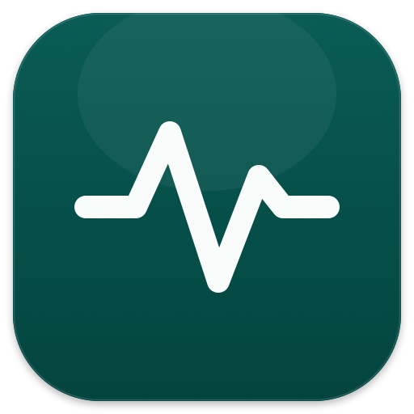
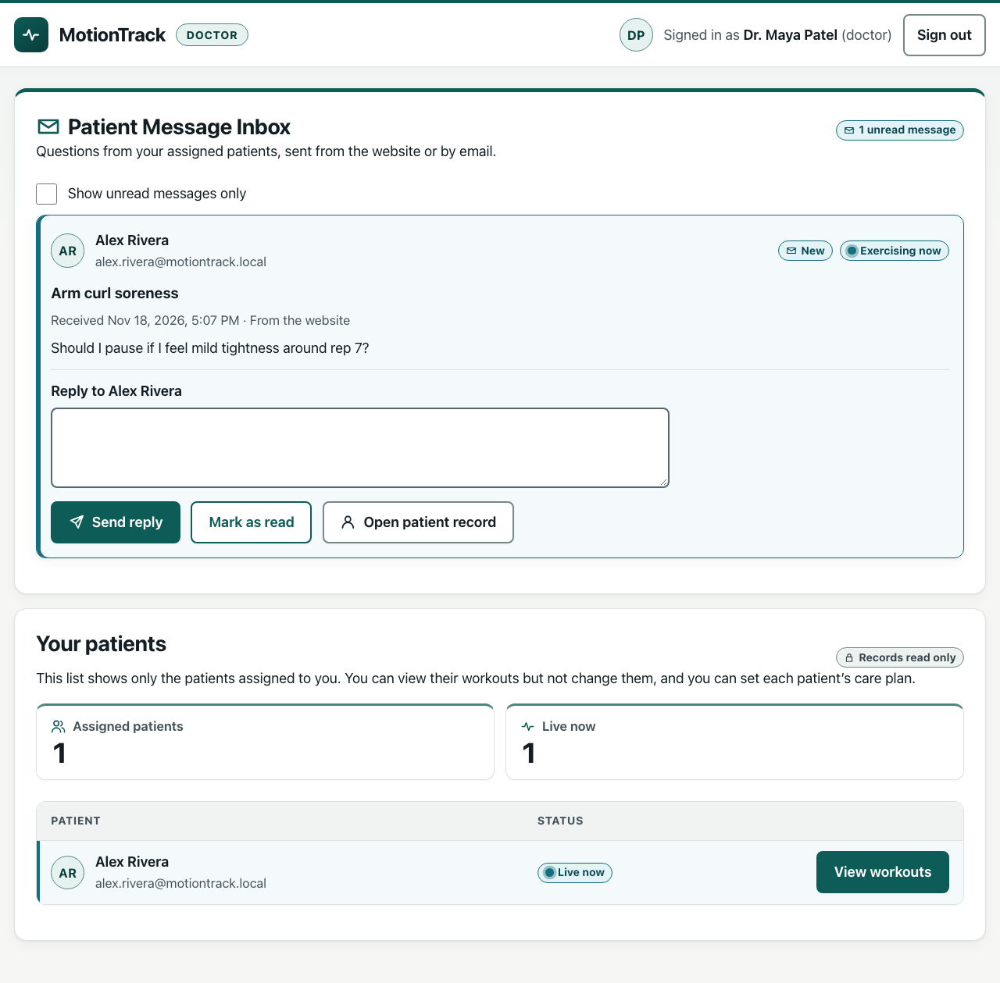

<div align="center">



# MotionTrack

**A forearm wearable, iOS companion, and clinical review dashboard for counting exercise reps and heart rate between supervised sessions.**

<sub>University of Waterloo · ECE 198 · Group 65 · Built for the CCCARE exercise-tracking brief</sub>

<p>
  
  
  
  
</p>

[Overview](#overview) · [Hardware & Rep Detection](#hardware--rep-detection) · [System Architecture](#system-architecture) · [Test Results](#wearable--software-test-results) · [Web Portals](#web-portals) · [Quick Start](#quick-start) · [Team & Credits](#team--credits)

<p>
  
</p>

<sup><em>Group 65 "Diamond Ends" Fusion CAD forearm enclosure (OLED readout illustrative).</em></sup>

</div>

---

## Overview

Between supervised cardiac/rehabilitation sessions (such as CCCARE clinics), participants have to maintain proper form, count repetitions mid-set, and remember totals afterward. If a set goes unrecorded, clinicians lack accurate adherence history at follow-up.

**MotionTrack** captures three concrete facts per set **locally on a forearm wearable** and syncs them to a review dashboard:
1. **Exercise type** (`Biceps curl / Arm Curl`, `Shoulder press`, `Back row`, 1–50 target reps)
2. **Completed repetitions** (counted live on an on-device OLED)
3. **Elapsed time + before/after heart rate (BPM)** measured via the **Motion Log** iOS camera pulse estimator or pulse sensor

An exercise record is marked **Complete** only when all target reps finish and both heart-rate readings exist (otherwise **Incomplete**). Retried HTTPS uploads from the phone are idempotent (`client_id`) and never double-count. The web app exposes **Patient** (`/`), **Doctor** (`/doctor`), and **Admin** (`/admin`) views (mapped to `participant`, `staff`, and `admin` in the backend API, CLI, and database).

---

## Hardware & Rep Detection

<div align="center">
  
</div>

### Wearable Hardware Architecture

| Subsystem | Part / Interface | Connection & Responsibility |
| :--- | :--- | :--- |
| **Microcontroller** | `ESP32 DOIT DevKit V1` | Runs IMU calibration, local rep-counting state machine, workout timer, and BLE GATT service |
| **Motion Sensor** | `MPU6050` (3-axis accel + gyro) | Connected via I²C (`GPIO 32 SDA`, `GPIO 33 SCL`); measures forearm tilt & angular velocity |
| **Wearable Display** | `SSD1306 OLED` | Connected via I²C (`GPIO 21 SDA`, `GPIO 22 SCL`); displays prompts, live count, and set results |
| **Power Rail** | `9 V` battery → Breadboard regulator | Regulated `+3.3 V` and common `GND` feeding ESP32, MPU6050, and SSD1306 OLED |
| **Enclosure** | 3D-printed *Diamond Ends* case | Secures the IMU cleanly along the forearm while keeping the OLED glanceable mid-set |
| **Wireless Link** | Bluetooth Low Energy (BLE) | Exchanges workout config and live counts with `Motion Log`; ESP32 keeps counting if BLE drops |

### 3-Stage Biceps Curl & Exercise Detection
To avoid counting accidental reaches or pausing mid-lift, rep state runs directly on the ESP32 (`TiltRepCounter.h` / `WristRepCounter.h`):
1. **Detect the lift:** Gyroscope angular motion registers forearm rotation and opens a candidate rep (counter remains at `0`).
2. **Check the range:** Forearm tilt must cross an exercise-specific minimum angle threshold (blocking incomplete lifts).
3. **Count on return:** Holding at the top remains in progress; the counter increments **only** when the arm returns near its starting calibration angle.

---

## System Architecture

<div align="center">
  
</div>

### iPhone Companion (`Motion Log`) & Camera Pulse Check

<p align="center">
  
</p>

- **Bluetooth Workout Session (`mobile/MotionLog/`):** Calibrates the forearm sensor while resting, selects an exercise & rep target, mirrors live counts over BLE, and lets users finish early without losing completed reps.
- **Camera PPG Pulse Estimation:** Measures fingertip pulse waveform before and after sets (supporting front-camera + screen light on iPhone 17 Pro / Pro Max, or rear lens; see [`mobile/README.md#iphone-camera-pulse`](mobile/README.md#iphone-camera-pulse)).
- **Offline Sync Queue + Dual Storage Backend:** `Motion Log` queues completed sets offline and retries idempotently over HTTPS to the Node + Express backend, storing records in local SQLite (`backend/data/ece198.sqlite`) or hosted Turso libSQL (`TURSO_DATABASE_URL`, `TURSO_AUTH_TOKEN`).
- **Legacy Wi-Fi Compatibility:** Direct ESP32-to-server Wi-Fi sketches under [`firmware/`](firmware/README.md) remain intact to preserve legacy device records alongside the unified Bluetooth + iPhone architecture in [`mobile/Firmware/`](mobile/setup-guide.md).

### Repository Layout

```text
motiontrack/
├── mobile/                 # SwiftUI iPhone app (Motion Log), BLE ESP32 firmware & accuracy/Swift tests
│   ├── MotionLog/          # BLE Tracker, Camera PPG (PulseCamera/PulseSignal) & Offline SyncCore
│   ├── Firmware/           # PlatformIO BLE firmware + forearm/wrist rep counters
│   └── tests/              # C++ rep accuracy benchmarks & Swift workout/pulse checks (run.sh)
├── firmware/               # Legacy Wi-Fi & single-file BLE sketch (MotionTrackSingle/) + host tests
├── backend/                # Node 24 + Express 5 + SQLite/Turso API, email bot, CLI manage.js & tests
├── frontend/               # React 19 + Vite dashboard (Patient /, Doctor /doctor, Admin /admin) + fake device
├── docs/
│   ├── assets/             # App icon, CAD hero, hardware/software diagrams & portal screenshots
│   ├── guides/             # End-user portal guide (user-guide.md) & full course demo script (demo.md)
│   └── design/             # Approved system specification (2026-11-18-motiontrack-design.md)
└── render.yaml             # One-click Render deployment blueprint (Node 24 + Turso env config)
```

---

## Wearable & Software Test Results

### Prototype Wearable Trials (Group 65 · 5 Trials · 50 Reference Reps / Exercise)

| Check / Exercise | Reference | Measured Result | Accuracy / Coverage |
| :--- | :--- | :--- | :---: |
| **Biceps curls** | `50` manual reference reps | `45` counted | **90%** |
| **Shoulder presses** | `50` manual reference reps | `42` counted | **84%** |
| **Back rows** | `50` manual reference reps | `40` counted | **80%** |
| **Software verification** | Host logic + simulated device | Automated backend, frontend, C++ & Swift suites | **Verified** |

> Note: Wearable percentages compare total counted vs. reference reps across trials; false positives and missed reps are tracked separately in bench tests (`docs/guides/demo.md`).

### Next-Prototype Focus
- **Movement calibration:** Benchmark varied strap placement, repetition cadence, and partial ranges of motion.
- **Wearable ergonomics:** Validate one-handed strap fastening and OLED glanceability under load.
- **Extended device support:** Expand mobile companion support to Android and validate cross-device camera PPG estimation.

---

## Web Portals

| Patient — Live Rep Session (`/`) | Patient — 30-Day Progress (`/`) |
| :---: | :---: |
|  |  |
| **Doctor — Care Plans & Inbox (`/doctor`)** | **Admin — System Overview (`/admin`)** |
|  |  |

---

## Quick Start

Run the full web platform locally **without hardware** (requires **Node.js 24+**):

```bash
# Terminal 1 — Express + SQLite API (:3000)
cd backend
npm ci
test -f .env || cp .env.example .env
npm start
```

```bash
# Terminal 2 — React + Vite Dashboard (:5173)
cd frontend
npm ci
test -f .env.local || cp .env.example .env.local
npm run dev
```

Visit **http://localhost:5173/** (Patient), **/doctor**, or **/admin**, or run the synthetic ESP32 emulator (`cd frontend && DEVICE_TOKEN='...' npm run fake-device`) as walked through in [`docs/guides/demo.md`](docs/guides/demo.md).

### Test Suites

| Component | Command | Covers |
| :--- | :--- | :--- |
| **Backend API & DB** | `cd backend && npm test` | Auth/roles, sessions, care plans, messages, migrations, SQLite/Turso, admin CLI |
| **Frontend UI** | `cd frontend && npm test && npm run build` | Care-plan validation, CSV export, exercise/BPM helpers, route/onboarding logic & Vite build |
| **Legacy Firmware** | `bash firmware/tests/run.sh` | C++17 host tests for motion thresholds & sensor logic |
| **Mobile BLE & Counter** | `bash mobile/tests/run.sh` | C++ wrist/tilt accuracy benchmarks + Swift BLE wire & PPG pulse-check tests |

### Documentation Index
- [`docs/guides/user-guide.md`](docs/guides/user-guide.md) — Patient, doctor, and admin portal walkthrough
- [`docs/guides/demo.md`](docs/guides/demo.md) — Complete demo setup (synthetic device, real ESP32, LAN/Cloudflare Tunnel, email bot)
- [`backend/README.md`](backend/README.md) — REST API, device protocol, SQLite/Turso schema, demo account seeding (`DEMO_*_PASSWORD`)
- [`frontend/README.md`](frontend/README.md) — Vite environment setup, proxy configuration & synthetic device flags
- [`firmware/README.md`](firmware/README.md) & [`mobile/README.md`](mobile/README.md) — Wiring, flashing, BLE setup guide ([`mobile/setup-guide.md`](mobile/setup-guide.md)), and iPhone camera PPG
- [`docs/design/2026-11-18-motiontrack-design.md`](docs/design/2026-11-18-motiontrack-design.md) — Approved engineering design record

---

## Team & Credits

**University of Waterloo · ECE 198 · Group 65**  
Jimmy Luo · Leo Xu · William Li · Zhexuan Li

**References:** University of Waterloo ECE 198 CCCARE project brief · Espressif ESP32 · TDK InvenSense MPU-6050 · Solomon Systech SSD1306 documentation.

<details>
<summary><strong>AI Disclosure &amp; Integrity Note</strong></summary>

Artificial intelligence tools (Claude / Anthropic and ChatGPT / OpenAI, Fall 2026) assisted with code implementation across firmware, mobile, and web software as well as CAD rendering and diagram illustration. System design, software architecture, sensing logic, hardware circuitry, physical prototyping, testing, and verification were completed and reviewed by **Group 65**. No real patient or identifiable clinical data was used.

</details>
