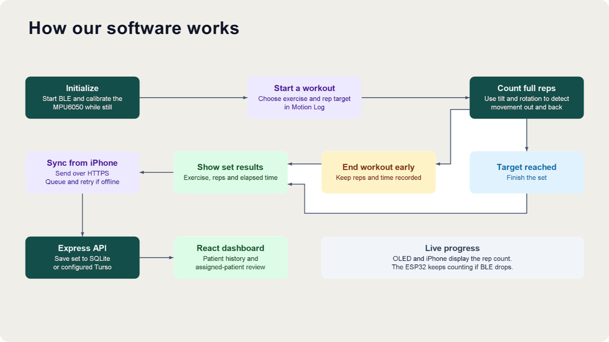
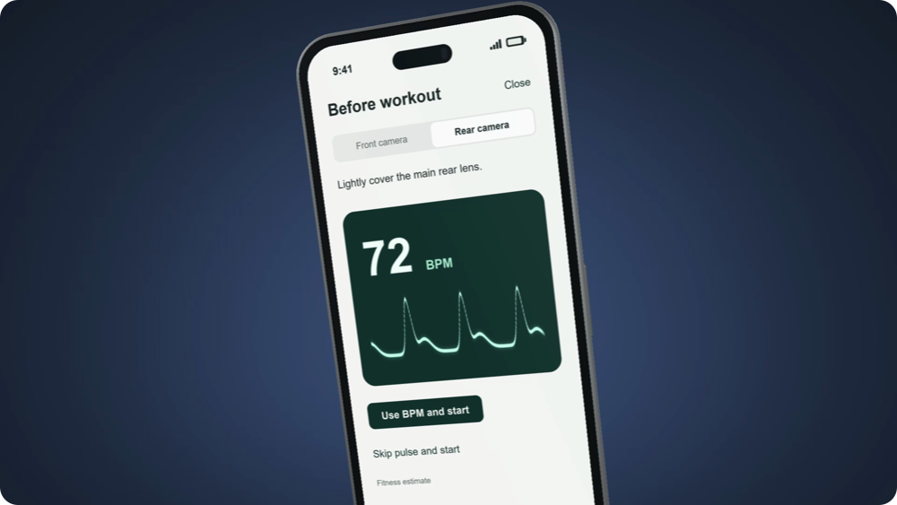

<div align="center">


# Motion Track

**A forearm wearable, iOS companion, and clinical review dashboard for counting exercise reps and heart rate between supervised sessions.**

<sub>University of Waterloo · ECE 198 · Group 65 · Built for the CCCARE exercise-tracking brief</sub>

<p>
  
  
  
  
</p>

[Web Demo](#web-demo) · [Overview](#overview) · [Hardware & Rep Detection](#hardware--rep-detection) · [System Architecture](#system-architecture) · [Test Results](#wearable--software-test-results) · [Web Portals](#web-portals) · [Quick Start](#quick-start) · [Team & Credits](#team--credits)

<p>
  
</p>

<sup><em>Group 65 "Diamond Ends" Fusion CAD forearm enclosure (OLED readout illustrative).</em></sup>

</div>

---

## Web Demo

The 31-second walkthrough shows which motions count in the wrist-sensor simulator, how patients follow a live workout, and what doctors and administrators see. It uses simulated sessions and sample accounts.

https://github.com/user-attachments/assets/94967187-dc10-49e1-82a1-2f25f1f75fb2

[Download the Motion Track walkthrough (MP4)](./docs/assets/motion-track-demo.mp4?raw=true) · [View the simulator screenshot](./docs/assets/screenshots/interactive-showcase.png)

To try it locally, open [`/#interactive-demo`](http://localhost:5173/#interactive-demo) after [starting the web app](#quick-start). Choose **Bicep curl**, **Shoulder press**, or **Back row**, then move the slider or select **Simulate 1 rep**. The OLED updates after a valid return. **Try shallow lift** shows how the simulator rejects a partial rep. The demo is available from the patient sign-in page without an account or wearable.

---

## Overview

Between supervised cardiac/rehabilitation sessions (such as CCCARE clinics), participants have to maintain proper form, count repetitions mid-set, and remember totals afterward. If a set goes unrecorded, clinicians lack accurate adherence history at follow-up.

**Motion Track** captures three concrete facts per set **locally on a forearm wearable** and syncs them to a review dashboard:
1. **Exercise type** (`Biceps curl / Arm Curl`, `Shoulder press`, `Back row`, 1–50 target reps)
2. **Completed repetitions** (counted live on an on-device OLED)
3. **Elapsed time + before/after heart rate (BPM)** measured via the **Motion Track** iOS camera pulse estimator or pulse sensor

An exercise record is marked **Complete** only when all target reps finish and both heart-rate readings exist (otherwise **Incomplete**). Retried HTTPS uploads from the phone are idempotent (`client_id`) and never double-count. The web app exposes **Patient** (`/`), **Doctor** (`/doctor`), and **Admin** (`/admin`) views (mapped to `participant`, `staff`, and `admin` in the backend API, CLI, and database).

---

## Hardware & Rep Detection

<div align="center">
  
</div>

### Wearable Hardware Architecture

| Subsystem | Part / Interface | Connection & Responsibility |
| :--- | :--- | :--- |
| **Microcontroller** | `ESP32 DOIT DevKit V1` | Runs IMU calibration, local rep-counting state machine, workout timer, and BLE GATT service |
| **Motion Sensor** | `MPU6050` (3-axis accel + gyro) | Connected via I²C (`GPIO 32 SDA`, `GPIO 33 SCL`); measures forearm tilt & angular velocity |
| **Wearable Display** | `SSD1306 OLED` | Connected via I²C (`GPIO 21 SDA`, `GPIO 22 SCL`); displays prompts, live count, and set results |
| **Power Rail** | `9 V` battery → Breadboard regulator | Regulated `+3.3 V` and common `GND` feeding ESP32, MPU6050, and SSD1306 OLED |
| **Enclosure** | 3D-printed *Diamond Ends* case | Secures the IMU cleanly along the forearm while keeping the OLED glanceable mid-set |
| **Wireless Link** | Bluetooth Low Energy (BLE) | Exchanges workout config and live counts with `Motion Track`; ESP32 keeps counting if BLE drops |

### Wrist-Strapped Rep Detection & Firmware Checks
For all three exercises, strap the `MPU6050` snugly **just above the wrist** of the working arm (holding the starting pose until **`Hold wrist still`** clears on the OLED for Shoulder press and Back row). Rep counting runs directly on the ESP32 (`TiltRepCounter.h` / `WristRepCounter.h`) and increments **only on the return**:
1. **Bicep curl (arm lowered, elbow by side):** Curl up until the forearm tilts **≥ 45°** from the bottom (`≥ 0.5 s` total, including `≥ 0.1 s` between crossing `45°` and returning), then lower within **20°** of resting angle (the first completed rep sets the lift direction).
2. **Shoulder press (hand at shoulder height):** Press overhead (**≥ 12 cm** lift) and lower back to shoulder height (**≥ 10.2 cm** return, **≥ 30 cm** combined).
3. **Back row (lean forward, working arm hanging):** Pull hand toward your hip (**≥ 10 cm** lift) and lower until hanging again (**≥ 8.5 cm** return, **≥ 25 cm** combined).
- **Press & row timing/symmetry guard:** Each direction must last **≥ 0.22 s**, with estimated return within **42%–380%** of the estimated lift.

---

## System Architecture

<div align="center">
  
</div>

### Motion Track iPhone Companion & Camera Pulse Check

<p align="center">
  
</p>

- **Bluetooth Workout Session (`mobile/MotionLog/`):** Calibrates the forearm sensor while resting, selects an exercise & rep target, mirrors live counts over BLE, and lets users finish early without losing completed reps.
- **Camera PPG Pulse Estimation:** Measures fingertip pulse waveform before and after sets (supporting front-camera + screen light on iPhone 17 Pro / Pro Max, or rear lens; see [`mobile/README.md#iphone-camera-pulse`](mobile/README.md#iphone-camera-pulse)).
- **Offline Sync Queue + Dual Storage Backend:** `Motion Track` queues completed sets offline and retries idempotently over HTTPS to the Node + Express backend, storing records in local SQLite (`backend/data/ece198.sqlite`) or hosted Turso libSQL (`TURSO_DATABASE_URL`, `TURSO_AUTH_TOKEN`).
- **Legacy Wi-Fi Compatibility:** Direct ESP32-to-server Wi-Fi sketches under [`firmware/`](firmware/README.md) remain intact to preserve legacy device records alongside the unified Bluetooth + iPhone architecture in [`mobile/Firmware/`](mobile/setup-guide.md).

### Repository Layout

```text
motiontrack/
├── mobile/                 # SwiftUI iPhone app, BLE ESP32 firmware & host tests
│   ├── MotionLog/          # BLE Tracker, Camera PPG (PulseCamera/PulseSignal) & Offline SyncCore
│   ├── Firmware/           # PlatformIO BLE firmware + forearm/wrist rep counters
│   └── tests/              # C++ rep counter simulations & Swift workout/pulse checks (run.sh)
├── firmware/               # Legacy Wi-Fi & single-file BLE sketch (MotionTrackSingle/) + host tests
├── backend/                # Node 24 + Express 5 + SQLite/Turso API, email bot, CLI manage.js & tests
├── frontend/               # React 19 + Vite dashboard (Patient /, Doctor /doctor, Admin /admin) + fake device
├── docs/
│   ├── assets/             # App icon, CAD hero, architecture diagrams, web demo & portal screenshots
│   ├── guides/             # End-user portal guide (user-guide.md) & full course demo script (demo.md)
│   └── design/             # Approved system specification (2026-11-18-motiontrack-design.md)
└── render.yaml             # One-click Render deployment blueprint (Node 24 + Turso env config)
```

---

## Wearable & Software Test Results

### Physical prototype trials

Group 65 reported these approximate results from testing the assembled wearable.

| Exercise | Team observation |
| :--- | :--- |
| Biceps curls | The wearable detected nearly 100% of reps. |
| Shoulder presses | The wearable missed about 1–2 reps out of 20, a detection rate of roughly 90–95%. |
| Back rows | The team observed a miss rate similar to shoulder presses. |

The [on-device verification steps](mobile/setup-guide.md#verify-the-setup) describe the manual-count comparison.

### Simulated rep counts

The [curl benchmark](mobile/tests/accuracy.cpp) and [wrist counter checks](mobile/tests/wrist.cpp) feed generated motion traces into the firmware counters. They compare counter totals with the expected reps for each simulated set.

| Exercise and test input | Expected reps | Counter total | Rep shortfall | Reps above expected |
| :--- | ---: | ---: | ---: | ---: |
| Biceps curls, standard simulation | 10,000 | 10,000 | 0 | 0 |
| Biceps curls, higher-noise stress simulation | 4,000 | 3,998 | 2 | 0 |
| Shoulder presses and back rows, simulated wrist motion | 224 | 224 | 0 | 0 |

Each curl run also included 1,400 rejection trials with movements such as partial lifts, tremor, and strap adjustments. Every rejection trial finished at or below its reference count.

### Automated software checks

All [test commands](#test-suites) passed on November 24, 2026, at revision `fbe3ead`. The backend runner reported 68 passes. The frontend passed 84 tests and built successfully. The legacy firmware passed 27 host checks. The mobile suite passed its host motion and workout checks, Swift packet decoding, offline sync, and synthetic camera pulse checks.

### Next-Prototype Focus
- **Movement calibration:** Benchmark varied strap placement, repetition cadence, and partial ranges of motion.
- **Wearable ergonomics:** Validate one-handed strap fastening and OLED glanceability under load.
- **Extended device support:** Expand mobile companion support to Android and validate cross-device camera PPG estimation.

---

## Web Portals

Portal loads, tabs, and patient-record navigation animate when reduced motion is off. Buttons, forms, and reply editors give visual feedback as you use them.

| Patient — Live Rep Session (`/`) | Patient — 30-Day Progress (`/`) |
| :---: | :---: |
|  |  |
| **Doctor — Patient Inbox (`/doctor`)** | **Admin — System Overview (`/admin`)** |
|  |  |

- **Patient (`/`)** follows active workouts in **Overview**, reviews synced sets in **History**, checks exercise totals and before-and-after heart rate in **Progress**, and contacts their doctor in **Messages**.
- **Doctor (`/doctor`)** replies to patient messages, filters assigned patients by activity and follow-up status, and opens each patient’s record to review workouts, set rep and heart-rate targets, and print clinical history.
- **Admin (`/admin`)** reviews clinic activity, assigns patients to doctors, and manages doctor accounts.

---

## Quick Start

Run the full web platform locally **without hardware** (requires **Node.js 24+**):

```bash
# Terminal 1 — Express + SQLite API (:3000)
cd backend
npm ci
test -f .env || cp .env.example .env
npm start
```

```bash
# Terminal 2 — React + Vite Dashboard (:5173)
cd frontend
npm ci
test -f .env.local || cp .env.example .env.local
npm run dev
```

Visit **http://localhost:5173/** (Patient), **/doctor**, or **/admin**. The patient landing page includes the [interactive wearable demo](http://localhost:5173/#interactive-demo). For the full system walkthrough, see the [course demo guide](docs/guides/demo.md).

### Test Suites

| Component | Command | Covers |
| :--- | :--- | :--- |
| **Backend API & DB** | `cd backend && npm test` | Auth/roles, sessions, participant triage counts, progress BPM aggregates, care plans, messages, migrations, SQLite/Turso, admin CLI |
| **Frontend UI** | `cd frontend && npm test && npm run build` | Care-plan validation, CSV export, exercise/BPM helpers, cohort triage & heart-rate filters, route/onboarding logic & Vite build |
| **Legacy Firmware** | `bash firmware/tests/run.sh` | C++17 host tests for motion thresholds & sensor logic |
| **Mobile firmware & Swift** | `bash mobile/tests/run.sh` | Simulated rep counts, workout flow, BLE packet decoding, sync, and synthetic camera pulse checks |

### Documentation Index
- [`docs/guides/user-guide.md`](docs/guides/user-guide.md) — Patient, doctor, and admin portal walkthrough
- [`docs/guides/demo.md`](docs/guides/demo.md) — Complete demo setup (synthetic device, real ESP32, LAN/Cloudflare Tunnel, email bot)
- [`backend/README.md`](backend/README.md) — REST API, device protocol, SQLite/Turso schema, demo account seeding (`DEMO_*_PASSWORD`)
- [`frontend/README.md`](frontend/README.md) — Vite environment setup, proxy configuration & synthetic device flags
- [`firmware/README.md`](firmware/README.md) & [`mobile/README.md`](mobile/README.md) — Wiring, flashing, BLE setup guide ([`mobile/setup-guide.md`](mobile/setup-guide.md)), and iPhone camera PPG
- [`docs/design/2026-11-18-motiontrack-design.md`](docs/design/2026-11-18-motiontrack-design.md) — Approved engineering design record

---

## Team & Credits

**University of Waterloo · ECE 198 · Group 65**  
Jimmy Luo · Leo Xu · William Li · Zhexuan Li

**References:** University of Waterloo ECE 198 CCCARE project brief · Espressif ESP32 · TDK InvenSense MPU-6050 · Solomon Systech SSD1306 documentation.

<details>
<summary><strong>AI Disclosure &amp; Integrity Note</strong></summary>

Artificial intelligence tools (Claude / Anthropic and ChatGPT / OpenAI, Fall 2026) assisted with code implementation across firmware, mobile, and web software as well as CAD rendering and diagram illustration. System design, software architecture, sensing logic, hardware circuitry, physical prototyping, testing, and verification were completed and reviewed by **Group 65**. No real patient or identifiable clinical data was used.

</details>
